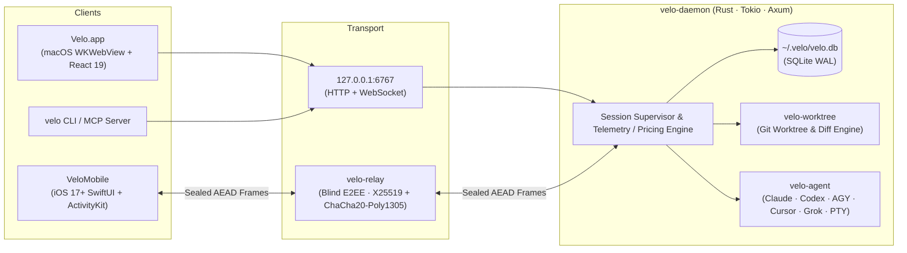

# ⚡ Velo

**Local-First Multi-Agent Coding Workspace & Zero-Trust Blind E2EE Mobile Companion**

[](https://www.rust-lang.org/)
[](https://react.dev/)
[](./scripts/build-macos-app.sh)
[](./apps/velo-ios)
[](#license)

Velo is a blazing-fast, local-first control plane for orchestrating parallel AI coding agents across isolated Git worktrees—paired with a native macOS `WKWebView` desktop app (`Velo.app`) and an end-to-end encrypted SwiftUI iOS companion (`VeloMobile`).

---

## ✨ Highlights

### 🤖 Multi-Engine Orchestration & Worktree Isolation
- **Unified Native Drivers**: Run **Claude Code**, **OpenAI Codex (`app-server`)**, **Google Antigravity (`agy` ACP)**, **Cursor Agent CLI**, **xAI Grok CLI**, and custom ACP/PTY runtimes side-by-side.
- **Git Worktree Automation**: Provision isolated worktrees per thread with automatic `.env` / dependency syncing and unified diff inspection (including untracked text files, empty-HEAD repos, and committed feature branches).
- **Composable Agent Workflows**: Built-in **Context Handoff** across engines, **Architect Advisor** diff review, parallel **Committee** racing, self-healing **TDD Verification Loops**, and a stdio **MCP Server** (`velo mcp`).

### 🧭 Calm, Engine-Aware Execution UX
- **Minimalist Interleaved Action Stream**: Chronological prose interleaved with borderless inline status lines (`✦ Thinking · 14s >`, `🔍 Checking branch ancestry · 8s >`) across Desktop and iOS, keeping focus on reasoning and results.
- **Native macOS Desktop Craft**: Three switchable surface materials (*Flat Matte*, *Frosted Glass*, *Elevated Specular*), Light/Dark/System themes + Tone presets, `⌘K` Command Palette, Master-Detail Settings (`⌘,`), keyboard-first approval (`Enter` / `A` / `Esc`) and question (`1–9`) cards, queued prompts bar, and clickable `file://` editor links.

### 📊 Subscription Quotas, Real-Time Telemetry & Official API Billing
- **Live Subscription Quota Windows**: Tracks real-time `5h / 7d / 30d` rate-limit windows (Antigravity & Cursor) with a recessed sidebar telemetry card, opaque portal breakdown popover, and full modal view.
- **Server-Side Telemetry & Billing Engine**: Authoritative `tok/s` measurement (excluding CLI cold-boot, prefill TTFT, and tool-execution pauses), prompt cache hit rate, cumulative-snapshot deduplication, and per-model API-equivalent cost breakdowns with hot-reloadable overrides at `~/.velo/pricing.json`.

### 🔐 Zero-Trust Blind E2EE Mobile Companion (`VeloMobile`)
- **2-Second QR Pairing**: `X25519` ECDH + forward-secret ephemeral ratchet + `ChaCha20-Poly1305` AEAD with exponential-backoff reconnection. The relay (`velo-relay`) routes opaque ciphertext frames and never sees prompts, code, or screenshots.
- **Tiered Encrypted Attachments**: Send and inspect screenshots between Mac and iOS (`800px` instant preview + `2200px` pinch-to-zoom HD) directly through the blind E2EE tunnel—no third-party cloud storage.
- **Mobile Git, PRs & Zero-Plaintext Wakeup Push**: Inspect unified diffs, Commit & Push, open/merge GitHub PRs with CI status, track Live Activities, and receive zero-plaintext lock-screen notifications via Bark or Webhook.

### 🗄️ Resilient Local Storage
- **SQLite WAL Persistence (`~/.velo/velo.db`)**: `O(1)` incremental event writes, WAL startup truncation, cursor pagination for 1,000+ step threads, rotating daemon logs, and instant cross-workspace full-text search.

---

## 🏗️ Architecture



---

## 📦 Workspace Layout

| Path | Description |
| :--- | :--- |
| `crates/velo-protocol` | Unified `AgentEvent` stream protocol, session DTOs, and WebSocket/RPC envelopes |
| `crates/velo-worktree` | Git worktree provisioning, `.env` / `node_modules` syncing, and unified diff engine |
| `crates/velo-agent` | Native streaming drivers for Claude, Codex `app-server`, ACP (`agy`), Cursor, Grok, and `portable-pty` |
| `crates/velo-daemon` | Axum control plane, SQLite WAL store, TPS/pricing/quota engines, Git/PR automation, blind push, and E2EE bridge |
| `crates/velo-relay` | Standalone zero-trust blind WebSocket relay server and QR pairing ticket generator |
| `crates/velo-cli` | Single-binary `velo` CLI with embedded daemon, MCP server, and macOS `LaunchAgent` manager |
| `apps/velo-desktop` | React 19 + Tailwind CSS v4 desktop UI and native Swift `WKWebView` macOS shell (`Velo.app`) |
| `apps/velo-ios` | Native iOS 17+ SwiftUI companion (`XcodeGen` project + WidgetKit Live Activities) |
| `deploy/cloudflare-blind-relay` | Cloudflare Workers Durable Object deployment for a serverless zero-trust blind relay |
| `scripts/` | Build, iOS deploy/simulator, and Cloudflare/VPS relay deployment automation scripts |

---

## 🚀 Quick Start

### Prerequisites
- **macOS 14+** (for `Velo.app` and `LaunchAgent` integration)
- **Rust** toolchain (`cargo`, edition 2024)
- **Node.js 20+** & **pnpm** (for `apps/velo-desktop`)
- **Xcode 16+** & **XcodeGen** (optional, for `apps/velo-ios`)
- At least one installed coding agent CLI (`claude`, `codex`, `agy`, `cursor-agent`, or `grok`)

### 1. Build & Install macOS Desktop App (`Velo.app`)
Builds the React UI, release Rust daemon/CLI, and native Swift `WKWebView` wrapper, installs into `/Applications/Velo.app`, and syncs the background macOS `LaunchAgent` (`~/.velo`):

```bash
./scripts/build-macos-app.sh
open /Applications/Velo.app
```

### 2. CLI & Background Daemon
```bash
cargo build --release -p velo-cli

# Start daemon (or manage always-on macOS LaunchAgent)
./target/release/velo up
./target/release/velo service install   # status | restart | uninstall

# Orchestrate sessions from the terminal
./target/release/velo run "Add integration tests for auth" --agent codex
./target/release/velo ps
./target/release/velo diff <session-id>
./target/release/velo logs <session-id> --follow

# Multi-agent workflows
./target/release/velo handoff <session-id> --to claude
./target/release/velo advisor <session-id> --agent codex
./target/release/velo committee "Refactor parser" --agents claude,codex
./target/release/velo loop "Fix failing tests" --check "cargo test" --agent claude

# Expose Velo as a stdio MCP server
./target/release/velo mcp
```

### 3. Build & Pair Native iOS Companion (`VeloMobile`)
```bash
# Run on iOS Simulator
./scripts/run-ios-simulator.sh

# Or build, sign, and wirelessly install onto your paired iPhone
./scripts/install-ios-device.sh
# (equivalent: ./target/release/velo ios)
```
Then open **Pair Mobile** in `Velo.app` (or run `velo pair`) and scan the **E2EE QR Code** from `VeloMobile`.

### 4. Deploy Your Own Zero-Trust Blind Relay (Optional)
For remote access outside your LAN, deploy the blind ciphertext relay to Cloudflare Workers or any VPS:

```bash
# Option A: Cloudflare Workers (Durable Objects)
./scripts/deploy-cloudflare-relay.sh

# Option B: Self-hosted Linux VPS (systemd + velo-relay)
./scripts/deploy-vps-relay.sh

# Option C: Run locally
./target/release/velo relay --listen 0.0.0.0:6768
```

---

## ⚙️ Configuration & Local Data

All local state stays strictly on your machine under `~/.velo/`:

| Path | Purpose |
| :--- | :--- |
| `~/.velo/velo.db` | SQLite WAL database (sessions, events, usage metrics, FTS search index) |
| `~/.velo/pricing.json` | Optional custom per-model API pricing overrides (hot-reloaded automatically on save) |
| `~/.velo/logs/` | Rotating daemon stdout/stderr logs |

Example `~/.velo/pricing.json` override:
```json
{
  "my-custom-model": {
    "input_per_m": 2.0,
    "cached_input_per_m": 0.2,
    "cache_write_per_m": 2.5,
    "output_per_m": 10.0
  }
}
```

---

## 🧪 Development & Testing

```bash
# Run Rust workspace unit tests
cargo test -p velo-agent -p velo-daemon -p velo-worktree

# Desktop frontend dev server & type-check
cd apps/velo-desktop
pnpm install
pnpm dev       # Vite HMR against local velo-daemon on :6767
pnpm build     # tsc && vite build
```

---

## 📄 License

Licensed under either of **Apache License, Version 2.0** or **MIT License** at your option.
