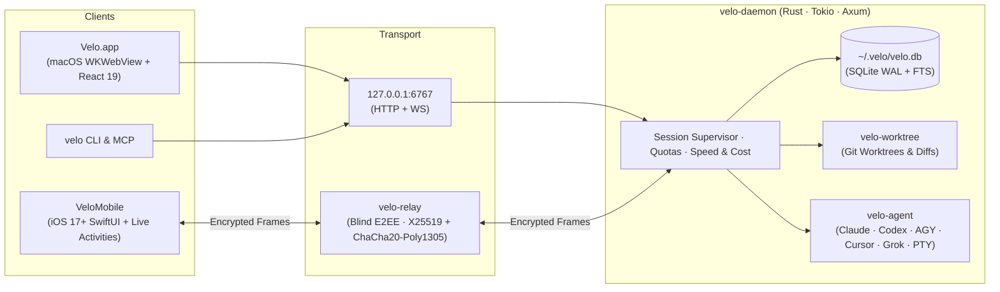

<div align="center">
  
  <h1>Velo</h1>
  <p>
    <strong>A native macOS workspace for your AI coding agents, with iPhone remote control built in.</strong>
  </p>

  <p>
    <a href="https://github.com/davaded/velo/actions/workflows/ci.yml"></a>
    <a href="https://github.com/davaded/velo/releases"></a>
    <a href="https://github.com/davaded/velo/stargazers"></a>
    <a href="#license"></a>
  </p>

  <p>
    <strong>English</strong> · <a href="./README.zh-CN.md">简体中文</a>
  </p>
</div>

---

Velo works with **Claude Code**, **Codex**, **Antigravity**, **Cursor**, **Grok**, and any **ACP** or **PTY** agent. If an agent is set up on your Mac, Velo can control it.

## What you get

- **Your subscriptions.** Velo does not resell tokens or proxy your requests through a cloud API. It drives the agents you are already signed in to.
- **Every agent in one place.** Run different engines side by side. Hand off a task and its worktree from one agent to another, call a second agent to review a diff, race multiple agents in parallel, or run a test loop until everything passes.
- **Remote control from your iPhone.** Scan a QR code once. Walk away from your Mac and still watch live progress, approve commands, inspect diffs and screenshots, commit, and open PRs from your phone—with iOS Live Activities and lock-screen alerts. Traffic is end-to-end encrypted between your Mac and iPhone so no relay server ever reads your code.
- **Git built in.** Each thread can run in its own isolated worktree with `.env` synced automatically. Review the diff, commit, push, and open a GitHub pull request with one click.
- **Quotas and real costs.** See live 5-hour, 7-day, and monthly subscription quotas right in the sidebar, along with real output speed (`tok/s`), cache hit rate, and per-model API-equivalent cost breakdowns.
- **Native and fast.** A local Rust daemon (`tokio` + SQLite) paired with a native macOS app and a native SwiftUI iOS app. Calm single-line progress traces (`✦ Thinking · 14s >`) instead of noisy tool walls, keyboard-first navigation (`⌘K`), and instant search across every repo.
- **Open.** Dual-licensed under MIT and Apache-2.0. Self-host the blind relay on Cloudflare Workers or your own VPS, or fork it and make it yours.

---

## Quick start

### macOS app

Download `Velo-macOS-arm64.dmg` from [GitHub Releases](https://github.com/davaded/velo/releases) and drag **Velo.app** into `/Applications`.

Or build from source (requires macOS 14+, Rust edition 2024, Node.js 22+, and `pnpm 9+`):

```bash
git clone https://github.com/davaded/velo.git
cd velo
./scripts/build-macos-app.sh
open /Applications/Velo.app
```

### iPhone companion (`VeloMobile`)

Requires Xcode 16+ and [XcodeGen](https://github.com/yonaskolb/XcodeGen):

```bash
# Simulator
./scripts/run-ios-simulator.sh

# Or build, sign, and wirelessly install to your paired iPhone
./scripts/install-ios-device.sh
```

Open **Pair Mobile** in Velo (or run `velo pair`) and scan the QR code from your iPhone. Works over your local network or remotely through your own relay.

---

## Supported engines

| Engine | Runtime / Protocol | Live quotas | Worktree & diff | iPhone remote |
| :--- | :--- | :---: | :---: | :---: |
| **Claude Code** | Native streaming CLI | — | Yes | Yes |
| **OpenAI Codex** | `codex app-server` | — | Yes | Yes |
| **Google Antigravity** | `agy` ACP | 5h / 7d | Yes | Yes |
| **Cursor Agent** | `cursor-agent` CLI | 30d | Yes | Yes |
| **xAI Grok** | Grok CLI | — | Yes | Yes |
| **Custom agents** | Generic ACP / PTY | — | Yes | Yes |

---

## Multi-agent CLI & MCP

Everything in the app is also scriptable from the `velo` CLI and exposed over stdio **MCP** (`velo mcp`):

```bash
velo run "Add integration tests for OAuth refresh" --agent codex
velo handoff <session-id> --to claude
velo advisor <session-id> --agent codex
velo committee "Refactor SQL query planner" --agents claude,codex
velo loop "Fix flaky checkout tests" --check "cargo test" --agent claude
velo mcp
```

---

## Architecture



---

## Reference & self-hosting

<details>
<summary><strong>Privacy & encryption details</strong></summary>

- **Local storage:** Sessions, diffs, search indexes, and metrics stay in `~/.velo/velo.db` on your Mac.
- **Encrypted phone link:** QR pairing performs `X25519` key exchange with forward-secret ratcheting. Every prompt, diff, and screenshot is sealed with `ChaCha20-Poly1305` before leaving your device; the relay only forwards opaque ciphertext.
- **No image hosts:** Screenshots travel directly over the encrypted link (`800px` preview + `2200px` HD).
- **Blank lock-screen wakeups:** Optional Bark / Webhook alerts send empty wakeup pings (`velo://session/…`) without exposing titles or code.

</details>

<details>
<summary><strong>Self-hosted remote relay (Cloudflare Workers / VPS)</strong></summary>

```bash
# Cloudflare Workers (Durable Objects)
./scripts/deploy-cloudflare-relay.sh

# Linux VPS (systemd + velo-relay)
./scripts/deploy-vps-relay.sh

# Local or Tailscale
velo relay --listen 0.0.0.0:6768
```

</details>

<details>
<summary><strong>Full CLI reference</strong></summary>

```bash
velo up [--foreground]                           # Start daemon on 127.0.0.1:6767
velo status                                      # Daemon health and workspace summary
velo service <install|status|restart|uninstall>  # Manage macOS LaunchAgent
velo ps                                          # List sessions and worktrees
velo logs <session> [--follow]                   # Stream structured events
velo diff <session>                              # Live unified diff
velo stop <session>                              # Stop a running session
velo pair [--relay <url>]                        # Print pairing QR code
velo relay [--listen 0.0.0.0:6768]               # Run local blind relay
velo ios [--device <udid>]                       # Build, sign & install VeloMobile
```

</details>

<details>
<summary><strong>Local data & custom model pricing (<code>~/.velo/pricing.json</code>)</strong></summary>

| Path | Purpose |
| :--- | :--- |
| `~/.velo/velo.db` | SQLite database (sessions, events, metrics, full-text search) |
| `~/.velo/pricing.json` | Optional per-model USD / 1M token overrides (hot-reloaded on save) |
| `~/.velo/logs/` | Rotating daemon logs |

```json
{
  "my-custom-model": {
    "input_per_m": 2.0,
    "cached_input_per_m": 0.2,
    "cache_write_per_m": 2.5,
    "output_per_m": 10.0
  }
}
```

</details>

<details>
<summary><strong>Workspace layout & development</strong></summary>

| Path | Responsibility |
| :--- | :--- |
| `crates/velo-protocol` | Unified `AgentEvent` protocol, DTOs, and RPC envelopes |
| `crates/velo-worktree` | Git worktree provisioning, `.env` syncing, and diff engine |
| `crates/velo-agent` | Native drivers for Claude, Codex, AGY, Cursor, Grok, and PTY |
| `crates/velo-daemon` | Axum control plane, SQLite store, quotas/pricing, PR automation, encrypted relay bridge |
| `crates/velo-relay` | Blind WebSocket relay and QR pairing generator |
| `crates/velo-cli` | Single-binary `velo` CLI, MCP server, and LaunchAgent manager |
| `apps/velo-desktop` | React 19 + Tailwind CSS v4 UI + native Swift `WKWebView` shell |
| `apps/velo-ios` | Native iOS 17+ SwiftUI app and WidgetKit Live Activities |
| `deploy/cloudflare-blind-relay` | Cloudflare Workers Durable Object relay |

```bash
cargo test --workspace
cd apps/velo-desktop && pnpm install && pnpm dev
cd apps/velo-desktop && pnpm build
```

</details>

---

## Contributing

Pull requests and issues are welcome. Run `cargo test --workspace` and `pnpm build` in `apps/velo-desktop` before opening a PR. If you use a coding agent on this repo, see [AGENTS.md](./AGENTS.md).

## License

Dual-licensed under [MIT](https://opensource.org/licenses/MIT) or [Apache-2.0](https://www.apache.org/licenses/LICENSE-2.0) at your option.
