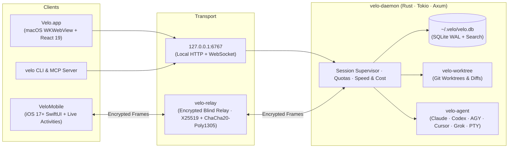

<div align="center">
  
  <h1>Velo</h1>
  <p>
    <strong>One native macOS workspace for all your AI coding agents —<br/>and remote-control every coding session from your iPhone.</strong>
  </p>

  <p>
    <a href="https://github.com/davaded/velo/actions/workflows/ci.yml"></a>
    <a href="https://github.com/davaded/velo/releases"></a>
    <a href="https://github.com/davaded/velo/stargazers"></a>
    
    <a href="#license"></a>
  </p>

  <p>
    <strong>English</strong> · <a href="./README.zh-CN.md">简体中文</a>
  </p>

  <p>
    <a href="#why-velo">Why Velo</a> ·
    <a href="#supported-engines">Engines</a> ·
    <a href="#quick-start">Quick Start</a> ·
    <a href="#multi-agent-superpowers">Workflows</a> ·
    <a href="#privacy--security">Privacy</a> ·
    <a href="#architecture">Architecture</a>
  </p>
</div>

---

## Why Velo?

Coding with AI agents today usually means juggling five terminal tabs, stepping on your own Git branch, and being chained to your desk just to click "Approve" or check if a long task finished.

**Velo fixes that — without asking you to give up your existing subscriptions or upload your code to the cloud:**

### 📱 Remote-Control Your Mac From Your iPhone
Scan a QR code once and pair your iPhone in 2 seconds. Step away from your desk and still **watch live progress, approve commands with one tap, inspect diffs and screenshots, send follow-up prompts, commit & open GitHub PRs**, and see real-time progress on iOS Live Activities & lock-screen alerts. Everything is encrypted directly between your Mac and iPhone—no cloud server ever sees your code.

### 🧩 One Workspace for Every AI Coding Agent
Use **Claude Code**, **OpenAI Codex**, **Google Antigravity**, **Cursor Agent**, **xAI Grok**, and custom CLI agents side by side in a single native macOS app. **Bring your own subscriptions**—Velo talks directly to the CLIs already logged in on your machine with zero token markups.

### 🌿 Run Tasks in Parallel Without Breaking Your Branch
Every chat thread gets its own isolated Git worktree (with `.env` synced automatically). Let Claude fix a bug while Codex writes tests and Antigravity refactors a module—all at the same time, with clean per-thread diffs and one-click PRs.

### 🤝 Let Multiple AIs Work Together
Don't settle for one model's opinion:
- **Handoff** — Pass a task's worktree and context from one engine to another mid-flight.
- **Advisor** — Summon a second agent to review the current diff and catch blind spots.
- **Committee** — Race multiple engines in parallel worktrees on the same problem and pick the best solution.
- **Self-Healing Loop** — Keep iterating automatically until your test command passes.

### 📊 Live Subscription Quotas & Clear Cost Tracking
See your real remaining **5-hour, 7-day, and monthly subscription quotas** with reset countdowns right in the sidebar—no more jumping to web dashboards. Inspect real output speed (`tok/s`), prompt cache hit rate, and transparent API-equivalent costs per model.

### ⚡ Native Speed, Calm UI
Powered by a local Rust daemon (`tokio` + SQLite) with a native macOS app and SwiftUI iOS app. No bloated nested tool boxes—just clean readable replies with compact live status lines (`✦ Thinking · 14s >`), `⌘K` Command Palette, keyboard-first approvals (`Enter` / `A` / `Esc`), and instant search across every workspace.

---

## Supported Engines

| Engine | How Velo Connects | Live Quota Bar | Isolated Worktree & Diff | iPhone Remote Control |
| :--- | :--- | :---: | :---: | :---: |
| **Claude Code** | Native streaming CLI | — | ✅ | ✅ |
| **OpenAI Codex** | `codex app-server` | — | ✅ | ✅ |
| **Google Antigravity** | `agy` ACP | ✅ `5h` / `7d` | ✅ | ✅ |
| **Cursor Agent** | `cursor-agent` CLI | ✅ `30d` | ✅ | ✅ |
| **xAI Grok** | Grok CLI | — | ✅ | ✅ |
| **Custom Agents** | Generic ACP / PTY | — | ✅ | ✅ |

---

## Quick Start

### 1. Download macOS App (Apple Silicon)

Download the latest `Velo-macOS-arm64.dmg` from [GitHub Releases](https://github.com/davaded/velo/releases), drag **Velo.app** to `/Applications`, and open it.

### 2. Or Build from Source

**Requirements:** macOS 14+, Rust (edition 2024), Node.js 22+ & `pnpm 9+`, and at least one logged-in coding CLI (`claude`, `codex`, `agy`, `cursor-agent`, or `grok`).

```bash
git clone https://github.com/davaded/velo.git
cd velo

# Build the desktop UI, Rust daemon/CLI, and native macOS app,
# install to /Applications/Velo.app, and sync the background LaunchAgent
./scripts/build-macos-app.sh
open /Applications/Velo.app
```

### 3. Pair Your iPhone (`VeloMobile`)

Requires Xcode 16+ and [XcodeGen](https://github.com/yonaskolb/XcodeGen).

```bash
# Run in iOS Simulator
./scripts/run-ios-simulator.sh

# Or build, sign, and wirelessly install onto your paired iPhone
./scripts/install-ios-device.sh
```

Open **Pair Mobile** in `Velo.app` (or run `velo pair`) and scan the QR code from your iPhone. Works over local Wi-Fi or remotely over your own relay.

---

## Multi-Agent Superpowers

Everything in the desktop and mobile apps is also available from the `velo` CLI—and exposed as a stdio **MCP server** (`velo mcp`) for other tools:

```bash
# Start a task in its own isolated Git worktree
velo run "Add integration tests for OAuth token refresh" --agent codex

# Hand off the worktree & progress to another engine
velo handoff <session-id> --to claude

# Ask a second engine to review the current diff
velo advisor <session-id> --agent codex

# Race two engines in parallel on the same task
velo committee "Refactor SQL query planner" --agents claude,codex

# Keep fixing automatically until tests pass
velo loop "Fix flaky checkout tests" --check "cargo test" --agent claude

# Expose Velo orchestration tools over MCP
velo mcp
```

---

## Privacy & Security

Remote phone control shouldn't mean trusting a cloud server with your source code:

- **100% Local-First**: Sessions, diffs, search indexes, and metrics live in `~/.velo/velo.db` on your Mac.
- **End-to-End Encrypted Phone Link**: Scanning the QR code exchanges `X25519` keys with forward-secret ratcheting. Every prompt, diff, and screenshot is encrypted (`ChaCha20-Poly1305`) before leaving your device—even the relay server only sees unreadable ciphertext.
- **No Third-Party Image Hosts**: Screenshots sent between Mac and iPhone travel directly over the encrypted link (`800px` instant preview + `2200px` pinch-to-zoom HD).
- **Private Lock-Screen Alerts**: Optional Bark / Webhook notifications send blank wakeup pings (`velo://session/…`) without leaking session titles or code.

---

## Architecture



---

## Reference & Self-Hosting

<details>
<summary><strong>Full CLI Reference</strong></summary>

```bash
velo up [--foreground]                           # Start background daemon on 127.0.0.1:6767
velo status                                      # Check daemon health and workspace summary
velo service <install|status|restart|uninstall>  # Manage macOS LaunchAgent autostart
velo ps                                          # List sessions and Git worktree states
velo logs <session> [--follow]                   # Stream structured session events
velo diff <session>                              # Inspect live unified diff for a worktree
velo stop <session>                              # Stop a running session
velo pair [--relay <url>]                        # Print pairing ticket & terminal QR code
velo relay [--listen 0.0.0.0:6768]               # Run a local encrypted relay server
velo ios [--device <udid>]                       # Build, sign & wirelessly install VeloMobile
```

</details>

<details>
<summary><strong>Self-Hosted Relay for Outside-LAN Phone Control (Cloudflare Workers / VPS)</strong></summary>

```bash
# Option A: Serverless Cloudflare Workers (Durable Objects)
./scripts/deploy-cloudflare-relay.sh

# Option B: Linux VPS (systemd + velo-relay)
./scripts/deploy-vps-relay.sh

# Option C: Local / Tailscale
velo relay --listen 0.0.0.0:6768
```

</details>

<details>
<summary><strong>Local Data & Custom API Pricing Overrides (<code>~/.velo/pricing.json</code>)</strong></summary>

| Path | Purpose |
| :--- | :--- |
| `~/.velo/velo.db` | Local SQLite database (sessions, events, usage metrics, full-text search) |
| `~/.velo/pricing.json` | Optional custom per-model USD / 1M token overrides (hot-reloaded on save) |
| `~/.velo/logs/` | Rotating daemon logs |

Example `~/.velo/pricing.json`:

```json
{
  "my-custom-model": {
    "input_per_m": 2.0,
    "cached_input_per_m": 0.2,
    "cache_write_per_m": 2.5,
    "output_per_m": 10.0
  }
}
```

</details>

<details>
<summary><strong>Workspace Layout & Development Commands</strong></summary>

| Path | Responsibility |
| :--- | :--- |
| `crates/velo-protocol` | Unified `AgentEvent` protocol, session DTOs, and RPC envelopes |
| `crates/velo-worktree` | Git worktree provisioning, `.env` syncing, and unified diff engine |
| `crates/velo-agent` | Native streaming drivers for Claude, Codex, AGY, Cursor, Grok, and PTY |
| `crates/velo-daemon` | Axum control plane, SQLite store, telemetry/pricing/quotas, PR automation, encrypted relay bridge |
| `crates/velo-relay` | Zero-trust blind WebSocket relay and QR pairing generator |
| `crates/velo-cli` | Single-binary `velo` CLI, MCP server, and macOS `LaunchAgent` manager |
| `apps/velo-desktop` | React 19 + Tailwind CSS v4 UI + native Swift `WKWebView` shell |
| `apps/velo-ios` | Native iOS 17+ SwiftUI app and WidgetKit Live Activities |
| `deploy/cloudflare-blind-relay` | Cloudflare Workers Durable Object blind relay |

```bash
# Run all Rust workspace tests
cargo test --workspace

# Desktop UI dev server with HMR against local daemon (:6767)
cd apps/velo-desktop && pnpm install && pnpm dev

# Type-check & production build
cd apps/velo-desktop && pnpm build
```

</details>

---

## Contributing

Contributions, issues, and feature ideas are welcome!

- Before opening a PR, run `cargo test --workspace` and `pnpm build` inside `apps/velo-desktop`.
- If you're using an AI coding assistant on this repo, point it to [AGENTS.md](./AGENTS.md) for exact commands and engineering guardrails.

## License

Dual-licensed under either [Apache License, Version 2.0](https://www.apache.org/licenses/LICENSE-2.0) or [MIT License](https://opensource.org/licenses/MIT) at your option.
