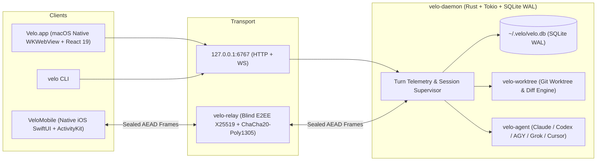

# ⚡ Velo

**Local-First Multi-Agent Coding Workspace & Zero-Trust Blind E2EE Mobile Companion**  
*Built natively with Rust (`tokio` + `axum` + `rusqlite` WAL), macOS `WKWebView`, React 19, and SwiftUI.*

---

## ✨ Key Capabilities

- **Multi-Engine Native Orchestration**: Run **Claude Code**, **OpenAI Codex (`app-server`)**, **Google Antigravity (`agy` ACP)**, **xAI Grok CLI**, **Cursor Agent CLI**, and custom ACP/PTY runtimes side-by-side.
- **Single-Engine Session Binding & Clean Handoff**: Every thread binds cleanly to one engine with lossless in-place or Git Worktree isolation, plus one-tap **Context Handoff**, **Architect Advisor**, **Committee Race**, and **TDD Verification Loops**.
- **Authoritative Server-Side Telemetry & Billing**: Real-time `tok/s` throughput engine (excluding CLI cold-boot, 200k prompt prefill TTFT, and tool execution pauses), prompt cache hit %, and model-accurate USD cost tracking across desktop and mobile.
- **Zero-Trust Blind E2EE Relay (`velo-relay`)**: Pair your iPhone in 2 seconds via QR code (`X25519` ECDH + ephemeral forward-secret ratchet + `ChaCha20-Poly1305` AEAD). The relay server routes opaque ciphertext frames and never sees prompts, code, or images.
- **Paseo-Style Tiered Encrypted Attachments**: Send and inspect screenshots across Mac and iOS (`800px` fast preview + `2200px` pinch-to-zoom HD) directly over the blind E2EE channel with zero third-party cloud storage.
- **SQLite WAL Storage & Global Search**: `O(1)` incremental event persistence (`~/.velo/velo.db`), cursor pagination for 1,000+ step threads, and instant cross-workspace full-text transcript search.
- **Full Mobile Git / PR / Voice / Blind Push**: Review unified diffs, Commit & Push, open/merge GitHub PRs with CI status, dictate prompts via voice, view Live Activities, and receive zero-plaintext lock-screen wakeup notifications (Bark / Webhook).

---

## 🏗️ Architecture



---

## 📦 Workspace Layout

| Path | Description |
| :--- | :--- |
| `crates/velo-protocol` | Unified `AgentEvent` stream protocol, session DTOs, and RPC envelopes |
| `crates/velo-worktree` | Git worktree provisioning, `.env` / `node_modules` syncing, and unified diff parser |
| `crates/velo-agent` | Native streaming drivers for Claude, Codex `app-server`, ACP (`agy`), Grok, Cursor, and `portable-pty` |
| `crates/velo-daemon` | Axum control plane, SQLite WAL store, TPS & pricing engine, PR/Git automation, blind push, and E2EE bridge |
| `crates/velo-relay` | Standalone static zero-trust blind WebSocket relay server + QR pairing generator |
| `crates/velo-cli` | Single-binary `velo` CLI with embedded daemon & macOS `LaunchAgent` service installer |
| `apps/velo-desktop` | React 19 + Tailwind CSS v4 desktop UI + native Swift `WKWebView` macOS shell |
| `apps/velo-ios` | Native iOS 17+ SwiftUI mobile companion (`XcodeGen` project) |

---

## 🚀 Quick Start

### 1. Build & Launch macOS App + Background Daemon
```bash
./scripts/build-macos-app.sh
open ./Velo.app
```

### 2. CLI Usage
```bash
cargo build --release -p velo-cli
./target/release/velo up
./target/release/velo ps
```

### 3. Build Native iOS Companion (`VeloMobile`)
```bash
cd apps/velo-ios
xcodegen generate
open VeloMobile.xcodeproj
```
Scan the **E2EE Pairing QR Code** in Velo Desktop (`Pair Mobile`) to link your iPhone over LAN or any self-hosted `velo-relay` endpoint.

---

## 📄 License

Licensed under either of **Apache License, Version 2.0** or **MIT License** at your option.
