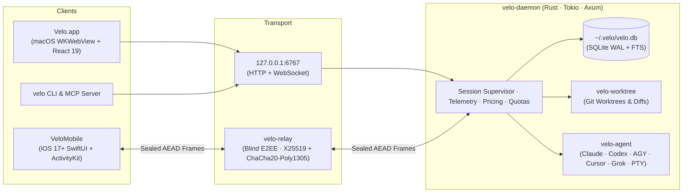

<div align="center">
  
  <h1>Velo</h1>
  <p>
    <strong>Run parallel AI coding agents in isolated Git worktrees —<br/>and control every session from your Mac or iPhone over zero-trust E2EE.</strong>
  </p>

  <p>
    <a href="https://github.com/davaded/velo/actions/workflows/ci.yml"></a>
    <a href="https://github.com/davaded/velo/releases"></a>
    <a href="https://github.com/davaded/velo/stargazers"></a>
    
    <a href="#license"></a>
  </p>

  <p>
    <strong>English</strong> · <a href="./README.zh-CN.md">简体中文</a>
  </p>

  <p>
    <a href="#why-velo">Why Velo</a> ·
    <a href="#supported-engines">Engines</a> ·
    <a href="#quick-start">Quick Start</a> ·
    <a href="#workflows">Workflows</a> ·
    <a href="#security-model">Security</a> ·
    <a href="#architecture">Architecture</a>
  </p>
</div>

---

## Why Velo?

Most coding-agent UIs force a trade-off: stay locked into a single vendor, juggle messy terminal tabs on one Git branch, or hand your source code to a cloud proxy just to check progress from your phone.

Velo takes a **local-first, zero-trust** approach:

- **Bring your own subscriptions** — No token markups and no cloud middleware. Velo drives the coding CLIs already authenticated on your Mac (**Claude Code**, **Codex**, **Antigravity**, **Cursor**, **Grok**, or any ACP/PTY agent).
- **True parallelism without branch chaos** — Every thread runs in an isolated Git worktree (with `.env` synced automatically), paired with unified diff review, one-click commits, and GitHub PR creation.
- **Walk away from your desk, stay in control** — Pair your iPhone in 2 seconds via QR code. Approve tool calls, inspect HD screenshots and diffs, watch iOS Live Activities, and receive zero-plaintext lock-screen wakeups while the relay sees only `ChaCha20-Poly1305` ciphertext.
- **Calm, native craft** — A Rust daemon (`tokio` + `axum` + SQLite WAL) powers a lightweight macOS `WKWebView` app and a native SwiftUI iOS app, complete with minimalist inline execution traces (`✦ Thinking · 14s >`), live subscription quota windows (`5h / 7d / 30d`), and transparent API-equivalent billing.

---

## Supported Engines

| Engine | Runtime / Protocol | Live Quotas | Worktree & Diff | Mobile E2EE |
| :--- | :--- | :---: | :---: | :---: |
| **Claude Code** | Native streaming CLI | — | ✅ | ✅ |
| **OpenAI Codex** | `codex app-server` | — | ✅ | ✅ |
| **Google Antigravity** | `agy` ACP | ✅ `5h` / `7d` | ✅ | ✅ |
| **Cursor Agent** | `cursor-agent` CLI | ✅ `30d` | ✅ | ✅ |
| **xAI Grok** | Grok CLI | — | ✅ | ✅ |
| **Custom Agents** | Generic ACP / `portable-pty` | — | ✅ | ✅ |

---

## Quick Start

### Option 1 — Download macOS App (Apple Silicon)

Grab the latest prebuilt `Velo-macOS-arm64.dmg` from [GitHub Releases](https://github.com/davaded/velo/releases), drag **Velo.app** to `/Applications`, and launch.

### Option 2 — Build from Source

**Prerequisites:** macOS 14+, Rust (edition 2024), Node.js 22+ & `pnpm 9+`, and at least one authenticated coding CLI (`claude`, `codex`, `agy`, `cursor-agent`, or `grok`).

```bash
git clone https://github.com/davaded/velo.git
cd velo

# Build React UI, release Rust daemon/CLI, and native macOS WKWebView bundle,
# install to /Applications/Velo.app, and sync the macOS LaunchAgent (~/.velo)
./scripts/build-macos-app.sh
open /Applications/Velo.app
```

### Option 3 — Pair the Native iOS Companion (`VeloMobile`)

Requires Xcode 16+ and [XcodeGen](https://github.com/yonaskolb/XcodeGen).

```bash
# Run in iOS Simulator
./scripts/run-ios-simulator.sh

# Or build, sign, and wirelessly install to your paired iPhone
./scripts/install-ios-device.sh
```

Click **Pair Mobile** in `Velo.app` (or run `velo pair`) and scan the QR code from `VeloMobile`. Works over LAN or any self-hosted blind relay.

---

## Workflows

### Desktop & Mobile Experience
- **Minimalist Execution Stream**: Clean interleaved prose and single-line live trace indicators (`✦ Thinking · 14s >`, `🔍 Checking branch ancestry · 8s >`) without noisy nested boxes.
- **Keyboard-First Productivity**: `⌘K` Command Palette, `⌘,` Master-Detail Settings, `Enter` / `A` / `Esc` approval shortcuts, `1–9` quick-select questions, queued prompts, clickable `file://` editor links, and 3 surface materials (*Flat Matte*, *Frosted Glass*, *Elevated Specular*).
- **Real Telemetry & Honest Billing**: Live `tok/s` (excluding cold-boot, prefill TTFT, and tool wait), prompt cache hit rate, cumulative-snapshot deduplication, real-time `5h / 7d / 30d` subscription quota cards, and per-model API-equivalent cost breakdowns.

### Multi-Agent CLI Orchestration
Every desktop capability is backed by the `velo` CLI and an embedded stdio **MCP server**:

```bash
# Run an agent in an isolated Git worktree
velo run "Add integration tests for OAuth refresh" --agent codex

# Hand off a worktree and conversation context to another engine
velo handoff <session-id> --to claude

# Spin up an independent reviewer agent on an active diff
velo advisor <session-id> --agent codex

# Race multiple engines in parallel worktrees on the same task
velo committee "Refactor SQL query planner" --agents claude,codex

# Run a self-healing TDD loop until tests pass
velo loop "Fix flaky checkout tests" --check "cargo test" --agent claude

# Expose Velo orchestration tools over stdio MCP
velo mcp
```

---

## Security Model

Velo's remote mobile control is built as a **zero-trust blind relay**:

| Layer | Design |
| :--- | :--- |
| **Key Exchange** | Out-of-band QR code (`X25519` ECDH + forward-secret ephemeral ratchet) |
| **Frame Encryption** | Every RPC message, diff, and image is sealed with `ChaCha20-Poly1305` AEAD before leaving your Mac or iPhone |
| **Blind Relay** | `velo-relay` (or the Cloudflare Durable Object worker) forwards opaque ciphertext frames only—it never sees keys, prompts, source code, or screenshots |
| **Encrypted Attachments** | Screenshots travel directly over the E2EE channel in tiered resolutions (`800px` preview + `2200px` pinch-to-zoom HD) with zero third-party cloud storage |
| **Blind Push Wakeups** | Optional Bark / Webhook notifications send zero-plaintext wakeup signals (`velo://session/…`) so push providers never see conversation titles or content |

---

## Architecture



---

## Reference & Self-Hosting

<details>
<summary><strong>Full CLI Reference</strong></summary>

```bash
velo up [--foreground]                # Start background daemon on 127.0.0.1:6767
velo status                           # Check daemon health and workspace summary
velo service <install|status|restart|uninstall>  # Manage macOS LaunchAgent
velo ps                               # List sessions and Git worktree states
velo logs <session> [--follow]        # Stream structured session events
velo diff <session>                   # Inspect live unified diff for a worktree
velo stop <session>                   # Stop a running session
velo pair [--relay <url>]             # Print E2EE pairing ticket & terminal QR
velo relay [--listen 0.0.0.0:6768]    # Run a local blind E2EE WebSocket relay
velo ios [--device <udid>]            # Build, sign & wirelessly install VeloMobile
```

</details>

<details>
<summary><strong>Self-Hosted Blind Relay Deployment (Cloudflare Workers / VPS)</strong></summary>

```bash
# Option A: Serverless Cloudflare Workers (Durable Objects)
./scripts/deploy-cloudflare-relay.sh

# Option B: Linux VPS with systemd + velo-relay
./scripts/deploy-vps-relay.sh

# Option C: Local / Tailscale relay
velo relay --listen 0.0.0.0:6768
```

</details>

<details>
<summary><strong>Local Data & Hot-Reloadable Custom Pricing (<code>~/.velo/pricing.json</code>)</strong></summary>

All state is stored locally under `~/.velo/`:

| Path | Purpose |
| :--- | :--- |
| `~/.velo/velo.db` | SQLite WAL store (sessions, incremental events, usage metrics, FTS search) |
| `~/.velo/pricing.json` | Optional per-model USD / 1M token overrides (hot-reloaded on save) |
| `~/.velo/logs/` | Rotating daemon logs |

Example `~/.velo/pricing.json`:

```json
{
  "my-custom-model": {
    "input_per_m": 2.0,
    "cached_input_per_m": 0.2,
    "cache_write_per_m": 2.5,
    "output_per_m": 10.0
  }
}
```

</details>

<details>
<summary><strong>Workspace Layout & Development Commands</strong></summary>

| Path | Responsibility |
| :--- | :--- |
| `crates/velo-protocol` | Unified `AgentEvent` protocol, session DTOs, and RPC envelopes |
| `crates/velo-worktree` | Git worktree provisioning, `.env` syncing, and unified diff engine |
| `crates/velo-agent` | Native streaming drivers for Claude, Codex, AGY, Cursor, Grok, and PTY |
| `crates/velo-daemon` | Axum control plane, SQLite WAL, telemetry/pricing/quotas, PR automation, E2EE bridge |
| `crates/velo-relay` | Zero-trust blind WebSocket relay and QR pairing generator |
| `crates/velo-cli` | Single-binary `velo` CLI, MCP server, and macOS `LaunchAgent` manager |
| `apps/velo-desktop` | React 19 + Tailwind CSS v4 UI + native Swift `WKWebView` shell |
| `apps/velo-ios` | Native iOS 17+ SwiftUI app and WidgetKit Live Activities |
| `deploy/cloudflare-blind-relay` | Cloudflare Workers Durable Object blind relay |

```bash
# Run all Rust workspace tests
cargo test --workspace

# Desktop UI dev server with HMR against local daemon (:6767)
cd apps/velo-desktop && pnpm install && pnpm dev

# Type-check & production build
cd apps/velo-desktop && pnpm build
```

</details>

---

## Contributing

Contributions, issues, and feature ideas are welcome!

- For human contributors, run `cargo test --workspace` and `pnpm build` in `apps/velo-desktop` before opening a PR.
- For AI coding assistants working in this repository, see [AGENTS.md](./AGENTS.md) for exact build commands, workspace rules, and WKWebView performance guardrails.

## License

Dual-licensed under either of [Apache License, Version 2.0](https://www.apache.org/licenses/LICENSE-2.0) or [MIT License](https://opensource.org/licenses/MIT) at your option.
