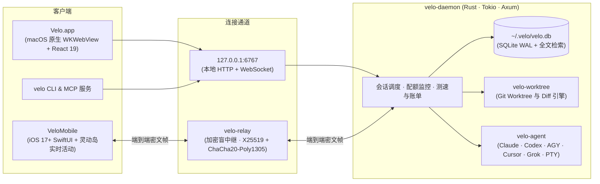

<div align="center">
  
  <h1>Velo</h1>
  <p>
    <strong>在一个原生 macOS 工作台里同时指挥多个 AI 写代码——<br/>离开电脑也能用 iPhone 随时遥控。</strong>
  </p>

  <p>
    <a href="https://github.com/davaded/velo/actions/workflows/ci.yml"></a>
    <a href="https://github.com/davaded/velo/releases"></a>
    <a href="https://github.com/davaded/velo/stargazers"></a>
    
    <a href="#开源协议"></a>
  </p>

  <p>
    <a href="./README.md">English</a> · <strong>简体中文</strong>
  </p>

  <p>
    <a href="#为什么用-velo">核心优势</a> ·
    <a href="#支持的-ai-引擎">支持引擎</a> ·
    <a href="#快速开始">快速开始</a> ·
    <a href="#多-ai-协同玩法">多 AI 协同</a> ·
    <a href="#隐私与安全">隐私安全</a> ·
    <a href="#系统架构">系统架构</a>
  </p>
</div>

---

## 为什么用 Velo？

现在用 AI 写代码，经常会遇到几个头疼的问题：不同工具要在好几个终端里来回切、多开任务容易把同一个 Git 分支改乱、跑一个长任务就得守在电脑前等它弹窗求审批。

**Velo 把这些痛点一次解决，而且不收一分钱差价、不把代码传上云端：**

### 📱 手机随时遥控，离开工位也能继续写代码
用 iPhone 扫一下二维码，2 秒连上你的 Mac。不管在开会、倒水还是躺沙发上，都能直接用手机**看实时进度、一键同意执行命令、查看代码 Diff、发截图追问、直接提交代码和提 GitHub PR**；任务等待审批或执行完成时，支持 iOS 灵动岛 / 锁屏实时活动和弹窗提醒。全程端到端加密，源码只存在于你的设备之间。

### 🧩 一个界面管所有主流 AI，直接用你自己的订阅
把 **Claude Code**、**OpenAI Codex**、**Google Antigravity**、**Cursor Agent**、**xAI Grok** 以及自定义 CLI 统一装进一个轻量原生桌面端。直接调用你本机已登录的账号和订阅，不中转、不加价、不绑定单一厂商。

### 🌿 多任务真正并行，代码互不打架
每开一个对话，Velo 自动分配独立的 Git Worktree（自动同步 `.env`）。你可以同时让 Claude 修 Bug、Codex 写单测、Antigravity 做重构——彼此完全隔离不污染主分支，做完直接看 Diff、一键合并或发 PR。

### 🤝 让多个 AI 互相配合，而不是单打独斗
- **一键交接（Handoff）**：写到一半想换模型？把当前分支改动和上下文直接移交给另一个引擎接着干。
- **双模型评审（Advisor）**：随时叫另一个 AI 当架构师，帮你审一遍当前 Diff 找漏洞。
- **多引擎竞速（Committee）**：把同一个难题同时分给多个 AI 在独立分支里并行实现，挑最好的方案合并。
- **测试自愈循环（TDD Loop）**：给它一条测试命令，自动改代码、跑测试、修报错，直到全部通过。

### 📊 订阅配额看得清，消耗账单算得明
左侧边栏直接实时显示 **5 小时 / 7 天 / 月度订阅剩余配额和重置倒计时**，不用切网页查；内置按各模型官方 API 单价折算的用量明细、真实生成速度（`tok/s`）与 Prompt 缓存命中率，一眼看清每一笔消耗。

### ⚡ 原生极速，界面克制不吵闹
Rust 后台引擎 + 原生 macOS 桌面端 + 原生 iOS SwiftUI 客户端。告别满屏工具调用刷屏，正文和单行实时状态（`✦ Thinking · 14s >`）自然穿插；支持 `⌘K` 全局命令面板、键盘快捷审批（`Enter` / `A` / `Esc`）、跨项目全文检索，以及三种界面材质随心切换。

---

## 支持的 AI 引擎

| AI 引擎 | 接入方式 | 实时配额条 | 独立 Worktree & Diff | 手机遥控 |
| :--- | :--- | :---: | :---: | :---: |
| **Claude Code** | 原生流式 CLI | — | ✅ | ✅ |
| **OpenAI Codex** | `codex app-server` | — | ✅ | ✅ |
| **Google Antigravity** | `agy` ACP | ✅ `5h` / `7d` | ✅ | ✅ |
| **Cursor Agent** | `cursor-agent` CLI | ✅ `30d` | ✅ | ✅ |
| **xAI Grok** | Grok CLI | — | ✅ | ✅ |
| **自定义 Agent** | 通用 ACP / PTY | — | ✅ | ✅ |

---

## 快速开始

### 1. 直接下载 macOS 安装包（Apple Silicon）

前往 [GitHub Releases](https://github.com/davaded/velo/releases) 下载最新的 `Velo-macOS-arm64.dmg`，拖进 `/Applications` 打开即可。

### 2. 或从源码一键编译安装

**环境要求**：macOS 14+、Rust（2024 edition）、Node.js 22+ & `pnpm 9+`，且本机至少登录了一个 AI 编程 CLI（`claude`、`codex`、`agy`、`cursor-agent` 或 `grok`）。

```bash
git clone https://github.com/davaded/velo.git
cd velo

# 一键编译桌面界面、Rust 后台引擎和原生 macOS 应用，
# 安装到 /Applications/Velo.app 并自动配置后台自启
./scripts/build-macos-app.sh
open /Applications/Velo.app
```

### 3. 连接 iPhone 手机遥控（`VeloMobile`）

需要 Xcode 16+ 与 [XcodeGen](https://github.com/yonaskolb/XcodeGen)。

```bash
# 在 iOS 模拟器体验
./scripts/run-ios-simulator.sh

# 或一键编译、签名并无线安装到你的 iPhone
./scripts/install-ios-device.sh
```

打开 `Velo.app` 点击左下角 **手机扫码连接**（或在终端运行 `velo pair`），用手机 App 扫一下二维码即可开始遥控。同一局域网可直连，出门在外可连自建中继。

---

## 多 AI 协同玩法

桌面端和手机端的所有编排能力，同样可以直接在终端通过 `velo` 命令调用，还自带 stdio **MCP 服务**（`velo mcp`）：

```bash
# 在独立 Git Worktree 里开一个编程任务
velo run "为 OAuth Token 刷新补充集成测试" --agent codex

# 把当前分支与上下文一键交接给另一个 AI 继续做
velo handoff <session-id> --to claude

# 叫另一个 AI 来评审当前代码改动
velo advisor <session-id> --agent codex

# 让多个 AI 并行竞速解同一个需求
velo committee "重构 SQL 查询规划器" --agents claude,codex

# 自动循环修改并运行测试，直到全部通过
velo loop "修复不稳定的结账测试" --check "cargo test" --agent claude

# 启动 MCP Server，让其他工具也能调用 Velo 编排能力
velo mcp
```

---

## 隐私与安全

手机远程遥控电脑写代码，最担心的就是代码泄露。Velo 从底层把隐私锁死：

- **数据 100% 留在本机**：所有对话记录、代码 Diff、全文检索索引与统计都保存在你 Mac 本地的 `~/.velo/velo.db`。
- **手机与电脑端到端加密**：扫码配对时直接协商 `X25519` 密钥，所有指令、代码 Diff 与截图都用 `ChaCha20-Poly1305` 加密后再发出；即使经过公网中继服务器，中继也只能看到乱码密文，无法窥探任何内容。
- **传图不走第三方图床**：Mac 与手机互发截图直接走加密通道（`800px` 极速预览 + `2200px` 双指放大高清图），不经过任何云存储。
- **锁屏提醒不泄密**：可选开启 Bark / Webhook 远程唤醒，推送通道只传唤醒信号（`velo://session/…`），不暴露任何对话标题和代码正文。

---

## 系统架构



---

## 进阶参考与自部署

<details>
<summary><strong>完整 CLI 命令速查</strong></summary>

```bash
velo up [--foreground]                           # 启动后台守护进程（127.0.0.1:6767）
velo status                                      # 查看运行状态与工作区摘要
velo service <install|status|restart|uninstall>  # 管理 macOS 开机自启服务
velo ps                                          # 查看所有会话与 Worktree 状态
velo logs <session> [--follow]                   # 实时跟踪会话事件流
velo diff <session>                              # 查看指定会话的代码 Diff
velo stop <session>                              # 终止正在运行的会话
velo pair [--relay <url>]                        # 在终端生成手机配对二维码
velo relay [--listen 0.0.0.0:6768]               # 启动本地加密中继服务
velo ios [--device <udid>]                       # 一键无线编译并安装 VeloMobile
```

</details>

<details>
<summary><strong>自建公网中继（出门在外也能用手机遥控）</strong></summary>

```bash
# 方案 A：一键部署到 Cloudflare Workers（Durable Objects，免费额度即可用）
./scripts/deploy-cloudflare-relay.sh

# 方案 B：部署到自有 Linux VPS（systemd + velo-relay）
./scripts/deploy-vps-relay.sh

# 方案 C：本地或 Tailscale 内网运行
velo relay --listen 0.0.0.0:6768
```

</details>

<details>
<summary><strong>本地数据目录与自定义模型单价（<code>~/.velo/pricing.json</code>）</strong></summary>

| 路径 | 用途 |
| :--- | :--- |
| `~/.velo/velo.db` | 本地 SQLite 数据库（会话、事件流、用量统计与全文检索） |
| `~/.velo/pricing.json` | 可选的自定义模型单价覆盖（美元 / 1M Tokens，保存即生效） |
| `~/.velo/logs/` | 自动轮转的守护进程日志 |

`~/.velo/pricing.json` 示例：

```json
{
  "my-custom-model": {
    "input_per_m": 2.0,
    "cached_input_per_m": 0.2,
    "cache_write_per_m": 2.5,
    "output_per_m": 10.0
  }
}
```

</details>

<details>
<summary><strong>代码目录结构与开发测试命令</strong></summary>

| 路径 | 职责说明 |
| :--- | :--- |
| `crates/velo-protocol` | 统一事件流协议、会话 DTO 与通信信封 |
| `crates/velo-worktree` | Git Worktree 创建、`.env` 同步与 Diff 解析 |
| `crates/velo-agent` | Claude、Codex、AGY、Cursor、Grok 与 PTY 驱动 |
| `crates/velo-daemon` | Axum 控制面、SQLite 存储、配额/测速/计费、PR 自动化与加密桥接 |
| `crates/velo-relay` | 独立加密盲中继 WebSocket 服务与配对二维码生成 |
| `crates/velo-cli` | 单二进制 `velo` CLI、MCP 服务与 macOS 后台服务管理 |
| `apps/velo-desktop` | React 19 + Tailwind CSS v4 桌面界面与原生 Swift `WKWebView` 外壳 |
| `apps/velo-ios` | 原生 iOS 17+ SwiftUI 客户端与灵动岛实时活动 |
| `deploy/cloudflare-blind-relay` | Cloudflare Workers Durable Object 中继工程 |

```bash
# 运行全部 Rust 单元测试
cargo test --workspace

# 启动桌面端前端热重载开发服务（直连本地 :6767 守护进程）
cd apps/velo-desktop && pnpm install && pnpm dev

# 前端类型检查与生产构建
cd apps/velo-desktop && pnpm build
```

</details>

---

## 参与贡献

欢迎提交 Issue、功能建议或 Pull Request！

- 提交 PR 前请确保 `cargo test --workspace` 和 `apps/velo-desktop` 下的 `pnpm build` 均通过。
- 如果使用 AI 编程助手协助开发本仓库，可先阅读 [AGENTS.md](./AGENTS.md) 了解构建命令与工程规范。

## 开源协议

本项目采用 [Apache License 2.0](https://www.apache.org/licenses/LICENSE-2.0) 与 [MIT License](https://opensource.org/licenses/MIT) 双协议开源，可任选其一使用。
