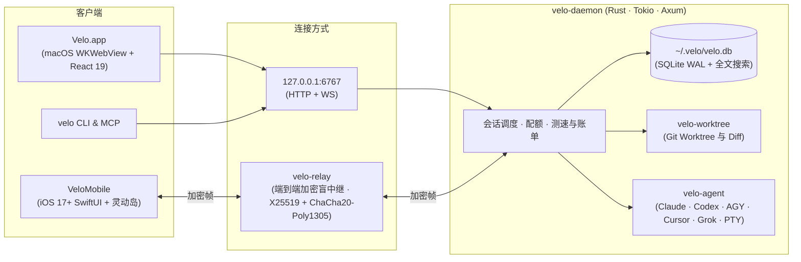

<div align="center">
  
  <h1>Velo</h1>
  <p>
    <strong>为你的所有 AI 编程 Agent 打造的原生 macOS 工作台，内置 iPhone 手机遥控。</strong>
  </p>

  <p>
    <a href="https://github.com/davaded/velo/actions/workflows/ci.yml"></a>
    <a href="https://github.com/davaded/velo/releases"></a>
    <a href="https://github.com/davaded/velo/stargazers"></a>
    <a href="#开源协议"></a>
  </p>

  <p>
    <a href="./README.md">English</a> · <strong>简体中文</strong>
  </p>
</div>

---

Velo 支持 **Claude Code**、**Codex**、**Antigravity**、**Cursor**、**Grok** 以及任意 **ACP** / **PTY** Agent。只要你的 Mac 上装好了这些工具，Velo 就能直接接管并调度它们。

## 你能得到什么

- **直接用你自己的订阅。** Velo 不倒卖 Token，也不通过云端 API 中转你的代码。它直接驱动你本机已经登录好的 Agent。
- **所有 Agent 装进一个地方。** 不同引擎同屏并行工作。随时把任务和 Worktree 交接给另一个模型，叫第二个 AI 帮你审 Diff，让多个引擎并行竞速，或者自动跑测试直到全部通过。
- **随时用 iPhone 遥控。** 扫一次二维码即可配对。离开电脑也能在手机上看实时进度、一键审批命令、看 Diff 和截图、提交代码并发 PR，支持灵动岛实时活动和锁屏提醒。Mac 和手机之间端到端加密，中继服务器看不到任何代码。
- **内置 Git Worktree。** 每条对话都可以跑在独立的 Worktree 里，`.env` 自动同步，互不打架。审完 Diff 一键提交、推送、创建 GitHub PR。
- **配额和成本一目了然。** 侧边栏直接看 5 小时、7 天和月度订阅余量及重置倒计时，同时记录真实输出速度（`tok/s`）、缓存命中率和按官方单价折算的各模型开销。
- **原生、快、不吵闹。** Rust 本地后台（`tokio` + SQLite）搭配原生 macOS 桌面端和原生 SwiftUI iOS 客户端。用克制的单行实时状态（`✦ Thinking · 14s >`）替代满屏刷屏的工具卡片，支持 `⌘K` 键盘流和跨项目瞬时搜索。
- **完全开源。** MIT / Apache-2.0 双协议开源。远程中继可一键部署到你自己的 Cloudflare Workers 或 VPS，也可以直接 Fork 改成你想要的样子。

---

## 快速开始

### macOS 桌面端

前往 [GitHub Releases](https://github.com/davaded/velo/releases) 下载 `Velo-macOS-arm64.dmg`，拖进 `/Applications` 即可使用。

或者从源码构建（需要 macOS 14+、Rust 2024 edition、Node.js 22+ 与 `pnpm 9+`）：

```bash
git clone https://github.com/davaded/velo.git
cd velo
./scripts/build-macos-app.sh
open /Applications/Velo.app
```

### iPhone 手机端（`VeloMobile`）

需要 Xcode 16+ 与 [XcodeGen](https://github.com/yonaskolb/XcodeGen)：

```bash
# 在模拟器运行
./scripts/run-ios-simulator.sh

# 或一键编译、签名并无线安装到你的 iPhone
./scripts/install-ios-device.sh
```

在 Velo 左下角点击 **手机扫码连接**（或终端运行 `velo pair`），用手机扫码即可开始遥控。同一局域网可直连，出门在外可连你自建的中继。

---

## 支持的引擎

| 引擎 | 接入协议 / 运行时 | 实时配额 | 独立 Worktree & Diff | 手机遥控 |
| :--- | :--- | :---: | :---: | :---: |
| **Claude Code** | 原生流式 CLI | 5h / 7d | 支持 | 支持 |
| **OpenAI Codex** | `codex app-server` | 5h / 7d | 支持 | 支持 |
| **Google Antigravity** | `agy` ACP | 5h / 7d | 支持 | 支持 |
| **Cursor Agent** | `cursor-agent` CLI | 30d | 支持 | 支持 |
| **xAI Grok** | Grok CLI | API 用量 | 支持 | 支持 |
| **自定义 Agent** | 通用 ACP / PTY | 网关 / API | 支持 | 支持 |

---

## 多 Agent 命令行与 MCP

界面里的所有编排能力都可以直接用 `velo` 命令行调用，同时也内置了 stdio **MCP 服务**（`velo mcp`）：

```bash
velo run "为 OAuth Token 刷新补充集成测试" --agent codex
velo handoff <session-id> --to claude
velo advisor <session-id> --agent codex
velo committee "重构 SQL 查询规划器" --agents claude,codex
velo loop "修复不稳定的结账测试" --check "cargo test" --agent claude
velo mcp
```

---

## 架构概览



---

## 进阶参考与自部署

<details>
<summary><strong>隐私与加密细节</strong></summary>

- **数据留在本机：** 所有会话、Diff、搜索索引和用量统计均保存在 Mac 本地的 `~/.velo/velo.db`。
- **端到端加密连接：** 扫码配对通过 `X25519` 协商密钥并启用前向安全棘轮，每条消息、Diff 和截图在离开设备前都会用 `ChaCha20-Poly1305` 加密，中继服务器只能看到密文。
- **不经第三方图床：** Mac 与手机互发截图直走加密通道（`800px` 预览 + `2200px` 高清原图）。
- **零明文锁屏唤醒：** 可选配置 Bark / Webhook，只发不含标题和内容的唤醒信号（`velo://session/…`）。

</details>

<details>
<summary><strong>自建公网中继（Cloudflare Workers / VPS）</strong></summary>

```bash
# Cloudflare Workers（Durable Objects）
./scripts/deploy-cloudflare-relay.sh

# Linux VPS（systemd + velo-relay）
./scripts/deploy-vps-relay.sh

# 本地或 Tailscale 内网
velo relay --listen 0.0.0.0:6768
```

</details>

<details>
<summary><strong>完整 CLI 命令速查</strong></summary>

```bash
velo up [--foreground]                           # 启动后台服务（127.0.0.1:6767）
velo status                                      # 查看运行状态与工作区摘要
velo service <install|status|restart|uninstall>  # 管理 macOS 开机自启
velo ps                                          # 列出所有会话与 Worktree
velo logs <session> [--follow]                   # 实时跟踪会话事件流
velo diff <session>                              # 查看实时统一 Diff
velo stop <session>                              # 停止运行中的会话
velo pair [--relay <url>]                        # 打印手机配对二维码
velo relay [--listen 0.0.0.0:6768]               # 启动本地加密中继
velo ios [--device <udid>]                       # 编译、签名并安装 VeloMobile
```

</details>

<details>
<summary><strong>本地数据与自定义模型单价（<code>~/.velo/pricing.json</code>）</strong></summary>

| 路径 | 用途 |
| :--- | :--- |
| `~/.velo/velo.db` | 本地 SQLite 数据库（会话、事件流、用量统计、全文搜索） |
| `~/.velo/pricing.json` | 可选的自定义模型单价覆盖（美元 / 1M Tokens，保存即热更新） |
| `~/.velo/logs/` | 自动轮转的后台日志 |

```json
{
  "my-custom-model": {
    "input_per_m": 2.0,
    "cached_input_per_m": 0.2,
    "cache_write_per_m": 2.5,
    "output_per_m": 10.0
  }
}
```

</details>

<details>
<summary><strong>目录结构与开发测试</strong></summary>

| 路径 | 说明 |
| :--- | :--- |
| `crates/velo-protocol` | 统一事件流协议、DTO 与 RPC 封装 |
| `crates/velo-worktree` | Git Worktree 管理、`.env` 同步与 Diff 引擎 |
| `crates/velo-agent` | Claude、Codex、AGY、Cursor、Grok 与 PTY 驱动 |
| `crates/velo-daemon` | Axum 控制面、SQLite 存储、配额/账单、PR 自动化与加密桥接 |
| `crates/velo-relay` | 盲中继 WebSocket 服务与扫码配对生成 |
| `crates/velo-cli` | 单二进制 `velo` CLI、MCP 服务与 LaunchAgent 管理 |
| `apps/velo-desktop` | React 19 + Tailwind CSS v4 界面与原生 Swift `WKWebView` 外壳 |
| `apps/velo-ios` | 原生 iOS 17+ SwiftUI 应用与 WidgetKit 实时活动 |
| `deploy/cloudflare-blind-relay` | Cloudflare Workers Durable Object 中继 |

```bash
cargo test --workspace
cd apps/velo-desktop && pnpm install && pnpm dev
cd apps/velo-desktop && pnpm build
```

</details>

---

## 参与贡献

欢迎提交 Issue 和 PR。提 PR 前请确保 `cargo test --workspace` 和 `apps/velo-desktop` 下的 `pnpm build` 通过。如果使用 AI 编程助手协作，请先查阅 [AGENTS.md](./AGENTS.md)。

## 开源协议

采用 [MIT](https://opensource.org/licenses/MIT) 或 [Apache-2.0](https://www.apache.org/licenses/LICENSE-2.0) 双协议开源，可任选其一使用。
