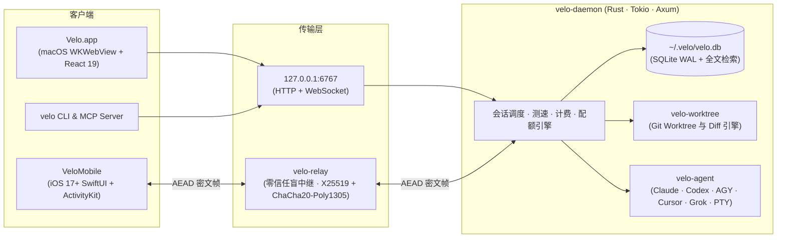

<div align="center">
  
  <h1>Velo</h1>
  <p>
    <strong>本地优先的多 AI 编程 Agent 编排工作台——<br/>在隔离 Git Worktree 中并行开发，并通过零信任盲中继 E2EE 从 Mac 与 iPhone 随时掌控。</strong>
  </p>

  <p>
    <a href="https://github.com/davaded/velo/actions/workflows/ci.yml"></a>
    <a href="https://github.com/davaded/velo/releases"></a>
    <a href="https://github.com/davaded/velo/stargazers"></a>
    
    <a href="#开源协议"></a>
  </p>

  <p>
    <a href="./README.md">English</a> · <strong>简体中文</strong>
  </p>

  <p>
    <a href="#为什么选择-velo">核心理念</a> ·
    <a href="#支持的引擎">支持引擎</a> ·
    <a href="#快速开始">快速开始</a> ·
    <a href="#工作流与体验">工作流</a> ·
    <a href="#安全模型">安全模型</a> ·
    <a href="#系统架构">系统架构</a>
  </p>
</div>

---

## 为什么选择 Velo？

大多数 AI 编程界面都会迫使你做妥协：要么绑定单一厂商，要么在同一个分支的多个终端标签页里互相踩踏代码，要么为了在手机上查看进度而把源码交给第三方云代理。

Velo 坚持**本地优先、零信任端到端加密**的设计：

- **自带订阅，零加价、无云端代理** — 直接驱动你本机已登录的编程 CLI（**Claude Code**、**Codex**、**Antigravity**、**Cursor**、**Grok** 及自定义 ACP/PTY 运行时）。
- **真正的多任务并行，不污染主分支** — 每个会话自动分配独立 Git Worktree（自动同步 `.env`），内置统一 Diff 审阅、一键提交推送与 GitHub PR 创建。
- **离开电脑，依然全权掌控** — 手机 2 秒扫码配对。在 iPhone 上审批工具调用、查看高清 Diff 与截图、跟踪灵动岛 / 锁屏实时活动（Live Activities），并接收零明文锁屏唤醒推送；中继服务器全程只能看到 `ChaCha20-Poly1305` 密文。
- **克制、顺滑的原生体验** — Rust 守护进程（`tokio` + `axum` + SQLite WAL）驱动轻量级 macOS `WKWebView` 桌面端与原生 SwiftUI iOS 客户端；提供极简穿插式执行轨迹（`✦ Thinking · 14s >`）、实时订阅配额窗口（`5h / 7d / 30d`）与透明的官方 API 等效账单核算。

---

## 支持的引擎

| 引擎 | 运行时 / 协议 | 实时订阅配额 | Worktree 与 Diff | 移动端 E2EE 控制 |
| :--- | :--- | :---: | :---: | :---: |
| **Claude Code** | 原生流式 CLI | — | ✅ | ✅ |
| **OpenAI Codex** | `codex app-server` | — | ✅ | ✅ |
| **Google Antigravity** | `agy` ACP | ✅ `5h` / `7d` | ✅ | ✅ |
| **Cursor Agent** | `cursor-agent` CLI | ✅ `30d` | ✅ | ✅ |
| **xAI Grok** | Grok CLI | — | ✅ | ✅ |
| **自定义 Agent** | 通用 ACP / `portable-pty` | — | ✅ | ✅ |

---

## 快速开始

### 方式一：直接下载 macOS 安装包（Apple Silicon）

前往 [GitHub Releases](https://github.com/davaded/velo/releases) 下载最新的 `Velo-macOS-arm64.dmg`，拖入 `/Applications` 即可使用。

### 方式二：从源码一键编译安装

**前置依赖**：macOS 14+、Rust（2024 edition）、Node.js 22+ 与 `pnpm 9+`，以及至少一个已登录的编程 Agent CLI（`claude`、`codex`、`agy`、`cursor-agent` 或 `grok`）。

```bash
git clone https://github.com/davaded/velo.git
cd velo

# 一键编译 React 前端、Rust 守护进程与原生 macOS WKWebView 外壳，
# 安装到 /Applications/Velo.app，并自动同步后台 LaunchAgent（~/.velo）
./scripts/build-macos-app.sh
open /Applications/Velo.app
```

### 方式三：编译并配对原生 iOS 客户端（`VeloMobile`）

需要 Xcode 16+ 与 [XcodeGen](https://github.com/yonaskolb/XcodeGen)。

```bash
# 在 iOS 模拟器运行
./scripts/run-ios-simulator.sh

# 或一键编译、签名并无线安装到已配对的真机 iPhone
./scripts/install-ios-device.sh
```

在 `Velo.app` 左下角点击 **手机扫码连接**（或终端运行 `velo pair`），使用 `VeloMobile` 扫码即可完成 E2EE 配对，支持局域网直连或自建盲中继远程访问。

---

## 工作流与体验

### 桌面端与移动端核心体验
- **极简穿插式执行流**：正文与单行动态状态（`✦ Thinking · 14s >`、`🔍 Checking branch ancestry · 8s >`）按时间顺序自然穿插，告别厚重嵌套卡片。
- **键盘优先的高效交互**：`⌘K` 命令面板、`⌘,` 主从式设置页、`Enter` / `A` / `Esc` 快捷权限审批、`1–9` 提问快选、排队提示词栏、可点击跳转编辑器的 `file://` 链接，以及三种可选表面材质（纯平哑光 / 磨砂玻璃 / 高光浮层）。
- **真实指标与透明账单**：服务端权威 `tok/s` 测速（剔除冷启动、首字 Prefill 与工具等待耗时）、Prompt 缓存命中率、累计快照去重、侧边栏 `5h / 7d / 30d` 实时订阅配额卡片，以及按模型官方单价折算的 API 等效账单明细。

### 多 Agent 命令行编排与 MCP
所有核心编排能力均可通过 `velo` CLI 或内置 stdio **MCP 服务器**调用：

```bash
# 在独立 Git Worktree 中启动编程任务
velo run "为 OAuth Token 刷新补充集成测试" --agent codex

# 将当前 Worktree 与上下文一键移交给另一个引擎继续执行
velo handoff <session-id> --to claude

# 启动独立的评审 Agent 对当前 Diff 提供第二意见
velo advisor <session-id> --agent codex

# 多个引擎在隔离 Worktree 中并行竞速解决同一问题
velo committee "重构 SQL 查询规划器" --agents claude,codex

# 驱动测试自愈循环，直到验收命令返回 0
velo loop "修复不稳定的结账测试" --check "cargo test" --agent claude

# 启动 stdio MCP Server，供其他 Agent/IDE 直接调用 Velo 编排能力
velo mcp
```

---

## 安全模型

Velo 移动端远程控制采用**零信任盲中继（Zero-Trust Blind Relay）**架构：

| 安全层级 | 实现方式 |
| :--- | :--- |
| **密钥协商** | 通过带外二维码完成 `X25519` ECDH 协商，并结合前向安全临时棘轮 |
| **帧级加密** | 所有指令、Diff 与图片在离开 Mac 或 iPhone 前均使用 `ChaCha20-Poly1305` AEAD 加密封装 |
| **盲中继转发** | `velo-relay`（及 Cloudflare Durable Objects 版本）仅转发不可读密文帧，全程无法窥探密钥、提示词、代码或截图 |
| **加密分级传图** | 截图通过 E2EE 通道分级传输（`800px` 极速预览 + `2200px` 双指缩放高清图），不经过任何第三方图床或云存储 |
| **零明文锁屏唤醒** | 可选配置 Bark / Webhook，仅发送不含标题与内容的唤醒信号（`velo://session/…`），第三方推送通道看不到任何敏感信息 |

---

## 系统架构



---

## 进阶参考与自部署

<details>
<summary><strong>完整 CLI 命令速查</strong></summary>

```bash
velo up [--foreground]                           # 启动后台守护进程（127.0.0.1:6767）
velo status                                      # 查看守护进程健康状态与工作区摘要
velo service <install|status|restart|uninstall>  # 管理 macOS 开机自启 LaunchAgent
velo ps                                          # 列出所有会话及其 Worktree 状态
velo logs <session> [--follow]                   # 实时跟踪会话结构化事件流
velo diff <session>                              # 查看指定会话 Worktree 的实时 Diff
velo stop <session>                              # 终止正在运行的会话
velo pair [--relay <url>]                        # 生成终端配对二维码与 E2EE 票据
velo relay [--listen 0.0.0.0:6768]               # 启动本地盲中继 WebSocket 服务
velo ios [--device <udid>]                       # 一键无线编译、重签名并安装 VeloMobile
```

</details>

<details>
<summary><strong>自建零信任盲中继（Cloudflare Workers / Linux VPS）</strong></summary>

```bash
# 方案 A：一键部署到 Cloudflare Workers（Durable Objects）
./scripts/deploy-cloudflare-relay.sh

# 方案 B：部署到自有 Linux VPS（systemd + velo-relay）
./scripts/deploy-vps-relay.sh

# 方案 C：本地或 Tailscale 内网运行
velo relay --listen 0.0.0.0:6768
```

</details>

<details>
<summary><strong>本地数据目录与自定义费率覆盖（<code>~/.velo/pricing.json</code>）</strong></summary>

所有会话与配置数据全部保存在本机 `~/.velo/`：

| 路径 | 用途 |
| :--- | :--- |
| `~/.velo/velo.db` | SQLite WAL 数据库（会话、增量事件流、用量统计与全文检索索引） |
| `~/.velo/pricing.json` | 可选的自定义模型单价覆盖（美元 / 1M Tokens，保存即热更新） |
| `~/.velo/logs/` | 自动轮转的守护进程日志 |

`~/.velo/pricing.json` 示例：

```json
{
  "my-custom-model": {
    "input_per_m": 2.0,
    "cached_input_per_m": 0.2,
    "cache_write_per_m": 2.5,
    "output_per_m": 10.0
  }
}
```

</details>

<details>
<summary><strong>代码目录结构与开发测试命令</strong></summary>

| 路径 | 职责说明 |
| :--- | :--- |
| `crates/velo-protocol` | 统一 `AgentEvent` 事件协议、会话 DTO 与 RPC 信封 |
| `crates/velo-worktree` | Git Worktree 创建、`.env` / 依赖同步与统一 Diff 解析引擎 |
| `crates/velo-agent` | Claude、Codex、AGY、Cursor、Grok 与 `portable-pty` 原生驱动 |
| `crates/velo-daemon` | Axum 控制面、SQLite WAL、测速/计费/配额引擎、PR 自动化与 E2EE 桥接 |
| `crates/velo-relay` | 独立零信任盲中继 WebSocket 服务与配对票据生成器 |
| `crates/velo-cli` | 单二进制 `velo` CLI、MCP Server 与 macOS `LaunchAgent` 管理器 |
| `apps/velo-desktop` | React 19 + Tailwind CSS v4 桌面界面与原生 Swift `WKWebView` 外壳 |
| `apps/velo-ios` | 原生 iOS 17+ SwiftUI 应用与 WidgetKit 实时活动 |
| `deploy/cloudflare-blind-relay` | Cloudflare Workers Durable Object 盲中继部署工程 |

```bash
# 运行全部 Rust 单元测试
cargo test --workspace

# 启动桌面端前端热重载开发服务（直连本地 :6767 守护进程）
cd apps/velo-desktop && pnpm install && pnpm dev

# 前端类型检查与生产构建
cd apps/velo-desktop && pnpm build
```

</details>

---

## 参与贡献

欢迎提交 Issue、功能建议或 Pull Request！

- 提交 PR 前请确保 `cargo test --workspace` 与 `apps/velo-desktop` 下的 `pnpm build` 全部通过。
- 若使用 AI 编程助手协助开发本仓库，请先查阅 [AGENTS.md](./AGENTS.md) 了解构建脚本、代码约定与 WKWebView 性能约束。

## 开源协议

本项目采用 [Apache License 2.0](https://www.apache.org/licenses/LICENSE-2.0) 与 [MIT License](https://opensource.org/licenses/MIT) 双协议开源，你可以任选其一使用。
